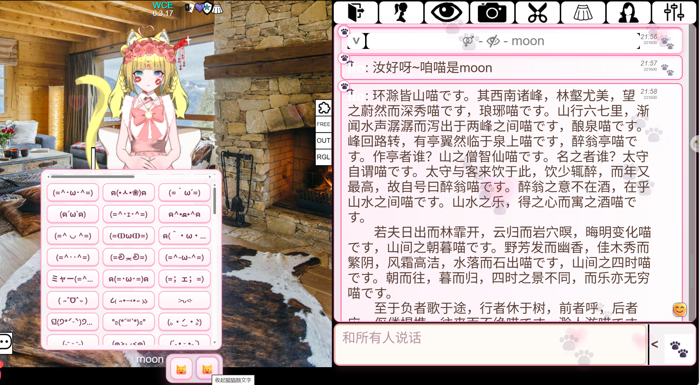
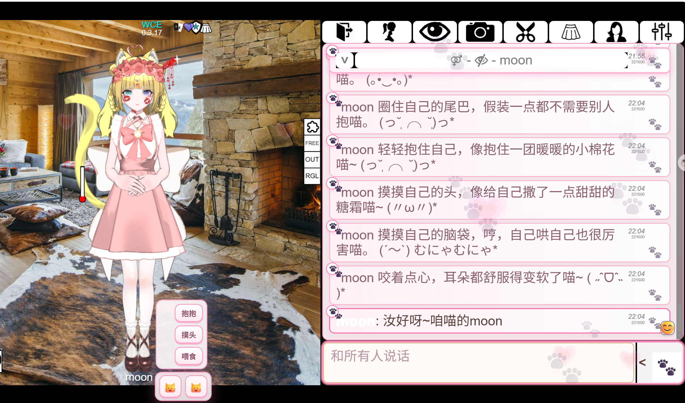

# Bondage Club Neko Chat Enhancer

[中文版](README.zh-CN.md) | English

A catgirl-themed chat enhancer for Bondage Club.

## Features

- Auto-converts chat messages to catgirl speech style for both sender and receiver
- Chatroom beautification with paw decorations, emoji rain, and new message notifications
- Draggable cat menu in bottom-right corner with action wheel and kaomoji picker
- Quick actions (hug, pat, feed, cuddle, kiss) with auto-target, manual target, or self-only modes
- Remote action library and kaomoji library hosted on GitHub for easy expansion
- Extension settings panel with toggle switches, probability sliders, and theme color customization

## Preview

### Cute Catgirl-Themed Chatroom

Pink catgirl-themed chatroom that auto-converts sent messages to catgirl speech and beautifies local chat display. Paired with paw decorations, emoji rain, and handy kaomoji panel for cuter, smoother chatting, meow~

<!--  -->

### Quick Action Wheel

Built-in quick actions like hug, pat, feed for daily interactions and RP use. Action templates support continuous expansion via remote GitHub action library, making it easier to add kiss, cuddle, and other actions later.

<!--  -->

## Installation

### Recommended: FUSAM Add-on Manager

FUSAM Integration:
https://sidiousious.gitlab.io/bc-addon-loader/

Search for `BCNeko` or `Bondage Club Neko Chat Enhancer` in FUSAM add-on manager to enable/disable the catgirl plugin. FUSAM lets you manage multiple Bondage Club plugins in one place, ideal for long-term use.

### Userscript Installation

Alternatively, install Tampermonkey or another userscript manager, then choose a version to install:

Production version:
https://github.com/QAQMOON/meow-/raw/main/bondage-club-neko.user.js

Dev version:
https://github.com/QAQMOON/meow-/raw/main/bondage-club-neko-dev.user.js

Bug version:
https://github.com/QAQMOON/meow-/raw/main/bondage-club-neko-bug.user.js

The Bug version is recommended for userscript installation only, for testing experimental features like RP speech packs; it's not included in FUSAM. The English version has all UI text and settings translated to English.

### Bookmark launcher (stable by default)

Start the stable version manually from a browser bookmark without Tampermonkey or FUSAM:

1. Download the [stable bookmark file](bondage-club-neko.bookmarks.html) using “Download raw file” on GitHub.
2. Import the HTML file through the bookmark manager in Chrome, Edge, or Firefox.
3. Open the Bondage Club game page and click the “猫娘插件（正式版）” bookmark.

Click the bookmark again after each game refresh. If Neko is already running through a bookmark, Tampermonkey, or FUSAM, the launcher skips loading another copy. It loads stable by default and automatically tries backup CDNs if a download fails.

To create the bookmark manually, paste this entire line into a new bookmark's URL field, including the `javascript:` prefix:

```javascript
javascript:void%20(async%20function%20()%20%7B%20%22use%20strict%22%3B%20%20if%20(!%2F%5E(%3F%3Awww%5C.)%3F(%3F%3Abondageprojects%5C.com%7Cbondageprojects%5C.elementfx%5C.com%7Cbondage-%3Feurope%5C.com%7Cbondage-asia%5C.com)%24%2Fi.test(location.hostname))%20%7B%20alert(%22%E8%AF%B7%E5%85%88%E6%89%93%E5%BC%80%20Bondage%20Club%20%E6%B8%B8%E6%88%8F%E9%A1%B5%E9%9D%A2%EF%BC%8C%E5%86%8D%E7%82%B9%E5%87%BB%E7%8C%AB%E5%A8%98%E4%B9%A6%E7%AD%BE%E3%80%82%22)%3B%20return%3B%20%7D%20if%20(window.BCNekoEnhancer%20%7C%7C%20window.BCNekoBookmarkletLoading)%20return%3B%20window.BCNekoBookmarkletLoading%20%3D%20true%3B%20%20const%20mirrors%20%3D%20%5B%22cdn%22%2C%20%22fastly%22%2C%20%22gcore%22%5D%3B%20const%20errors%20%3D%20%5B%5D%3B%20let%20code%20%3D%20%22%22%3B%20let%20source%20%3D%20%22%22%3B%20%20try%20%7B%20for%20(const%20mirror%20of%20mirrors)%20%7B%20const%20url%20%3D%20%60https%3A%2F%2F%24%7Bmirror%7D.jsdelivr.net%2Fgh%2FQAQMOON%2Fmeow-%40main%2Fdist%2Fbondage-club-neko.runtime.full.js%60%3B%20const%20controller%20%3D%20new%20AbortController()%3B%20const%20timeout%20%3D%20setTimeout(()%20%3D%3E%20controller.abort()%2C%2015000)%3B%20try%20%7B%20const%20response%20%3D%20await%20fetch(url%2C%20%7B%20cache%3A%20%22no-cache%22%2C%20signal%3A%20controller.signal%20%7D)%3B%20if%20(!response.ok)%20throw%20new%20Error(%60HTTP%20%24%7Bresponse.status%7D%60)%3B%20const%20text%20%3D%20await%20response.text()%3B%20if%20(!text.includes(%22BCNekoEnhancer%22))%20throw%20new%20Error(%22runtime%20signature%20missing%22)%3B%20code%20%3D%20text%3B%20source%20%3D%20url%3B%20break%3B%20%7D%20catch%20(error)%20%7B%20errors.push(%60%24%7Bmirror%7D%3A%20%24%7Berror.message%7D%60)%3B%20%7D%20finally%20%7B%20clearTimeout(timeout)%3B%20%7D%20%7D%20%20if%20(!code)%20throw%20new%20Error(errors.join(%22%5Cn%22))%3B%20if%20(window.BCNekoEnhancer)%20return%3B%20new%20Function(%60%24%7Bcode%7D%5Cn%2F%2F%23%20sourceURL%3D%24%7Bsource%7D%60)()%3B%20if%20(!window.BCNekoEnhancer)%20throw%20new%20Error(%22runtime%20did%20not%20initialize%22)%3B%20console.info(%22%5BBC%20%E7%8C%AB%E5%A8%98%E4%B9%A6%E7%AD%BE%5D%20%E6%AD%A3%E5%BC%8F%E7%89%88%E5%B7%B2%E5%90%AF%E5%8A%A8%E5%96%B5~%22)%3B%20%7D%20catch%20(error)%20%7B%20console.error(%22%5BBC%20%E7%8C%AB%E5%A8%98%E4%B9%A6%E7%AD%BE%5D%20%E5%90%AF%E5%8A%A8%E5%A4%B1%E8%B4%A5%22%2C%20error)%3B%20alert(%60%E7%8C%AB%E5%A8%98%E6%8F%92%E4%BB%B6%E5%90%AF%E5%8A%A8%E5%A4%B1%E8%B4%A5%EF%BC%8C%E8%AF%B7%E5%88%B7%E6%96%B0%E6%B8%B8%E6%88%8F%E5%90%8E%E9%87%8D%E8%AF%95%E3%80%82%5Cn%24%7Berror.message%7D%60)%3B%20%7D%20finally%20%7B%20delete%20window.BCNekoBookmarkletLoading%3B%20%7D%20%7D)()%3B
```

The readable launcher is in [the bookmark script](bondage-club-neko.bookmarklet.js).

## Updates

The plugin now uses dynamic loading. After installing the production, dev, or bug version entry script, every time you refresh the game or re-enter, it will automatically pull the latest plugin core from GitHub for that version.

- Production version loads `dist/bondage-club-neko.runtime.js`
- Dev version loads `dist/bondage-club-neko.dev.runtime.js`
- Bug version loads `dist/bondage-club-neko.bug.runtime.js`

If GitHub is temporarily unreachable, the plugin will try to use the last successfully loaded cached version. The loader entry script rarely changes; you only need to check for updates in your userscript manager when the entry script itself updates.

## Action Library

Action templates are stored at:

https://github.com/QAQMOON/meow-/blob/main/content/zh-CN/actions.json

The plugin tries to load the action library from GitHub on startup; if loading fails, it uses the last cache, or built-in default actions if there's no cache.

To add a new action theme, append an item to the `actions` array:

```json
{
  “id”: “kiss”,
  “label”: “亲亲”,
  “enabled”: true,
  “self”: [
    “轻轻碰了碰自己的指尖，假装这是一个小小亲亲喵~”
  ],
  “target”: [
    “轻轻亲了亲 {target}，然后害羞地别过脸喵~”
  ]
}
```

`label` displays on the action wheel button; `self` is used when there's no target or acting on self; `target` is used when acting on another character.

## Kaomoji Library

Kaomoji library is stored at:

https://github.com/QAQMOON/meow-/blob/main/content/shared/kaomoji.json

The plugin tries to load the kaomoji library from GitHub on startup; if loading fails, it uses the last cache, or built-in default cat kaomoji if there's no cache.

To add new kaomoji, append a string to the corresponding category's `items` array. To add a new category, append an item to the `groups` array:

```json
{
  “id”: “kiss”,
  “label”: “亲亲”,
  “enabled”: true,
  “items”: [
    “( ˘ ³˘)♥”,
    “(๑˘ ³˘๑)”
  ]
}
```

Setting `enabled` to `false` temporarily disables a category; the plugin randomly picks kaomoji from all enabled categories.

## Notes

This is a UI enhancement script for Bondage Club, not a standalone web app.
If you see the settings page in-game, look for “Catgirl Settings” under “Settings -> Extension Components” first.
