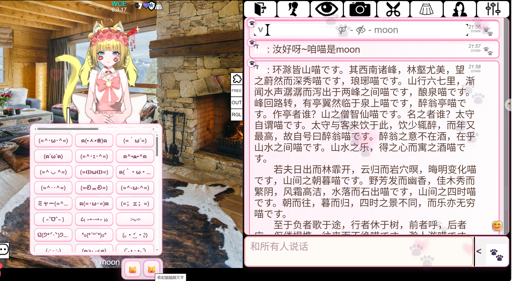
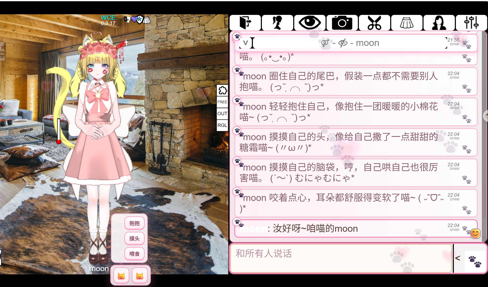

# Bondage Club Neko Chat Enhancer

一个给 Bondage Club 用的猫娘主题。

## 功能

- 聊天消息可自动转换成猫娘语气，发送方本地记录和接收方显示都可生效
- 聊天室美化、猫爪表情雨和新消息提醒，让界面更有猫娘主题感
- 右下角猫猫菜单支持拖动、展开/收起、动作轮盘和颜文字选择器
- 抱抱、摸头、喂食、贴贴、亲亲等动作支持自动目标、手动目标或只对自己
- GitHub 远程动作库与颜文字库，方便后续继续扩展内容
- 扩展组件设置页支持功能开关、概率调节和主题颜色切换

## 预览

### 猫娘可爱主题聊天室

粉色猫娘主题聊天室，自动将发送消息转换成猫娘语气，并同步美化本地聊天显示。搭配猫爪装饰、表情雨和便捷颜文字面板，让聊天更可爱、更顺手，喵~

<!--  -->

### 便捷动作轮盘

内置抱抱、摸头、喂食等快捷动作，适合日常互动和 RP 使用。动作文案支持通过 GitHub 远程动作库持续扩展，之后想增加亲亲、贴贴等动作也更方便。

<!--  -->

## 安装

### 推荐使用：FUSAM 插件管理器

FUSAM Integration:
https://sidiousious.gitlab.io/bc-addon-loader/

在 FUSAM 插件管理器里搜索 `BCNeko` 或 `Bondage Club Neko Chat Enhancer`，即可启用/禁用猫娘插件。FUSAM 可以在同一个地方管理多个 Bondage Club 插件，更适合长期使用。

### 油猴安装

也可以先安装油猴或其他 userscript 管理器，然后选择一个版本安装：

正式版：
https://github.com/QAQMOON/meow-/raw/main/bondage-club-neko.user.js

测试版：
https://github.com/QAQMOON/meow-/raw/main/bondage-club-neko-dev.user.js

Bug 版：
https://github.com/QAQMOON/meow-/raw/main/bondage-club-neko-bug.user.js

英文版（UI 英文化）：
https://github.com/QAQMOON/meow-/raw/main/bondage-club-neko.en.user.js

Bug 版只建议用油猴安装，用来测试 RP 语气包等实验功能；不加入 FUSAM。英文版将所有 UI 文本和设置翻译为英文。

### 书签启动（默认正式版）

无需安装油猴或 FUSAM，也可以通过浏览器书签手动启动正式版：

1. 下载 [正式版书签文件](bondage-club-neko.bookmarks.html)（在 GitHub 文件页点击下载原始文件）。
2. 在 Chrome、Edge 或 Firefox 的书签管理器中选择“导入书签”，导入下载的 HTML 文件。
3. 打开 Bondage Club 游戏页面，点击“猫娘插件（正式版）”书签。

每次刷新游戏后，需要再次点击书签。若猫娘插件已经通过书签、油猴或 FUSAM 启动，会跳过重复加载。默认使用正式版，加载失败时自动尝试备用 CDN。

也可以手动新建书签，将下面整行代码粘贴到书签的网址栏，保留开头的 `javascript:`：

```javascript
javascript:void%20(async%20function%20()%20%7B%20%22use%20strict%22%3B%20%20if%20(!%2F%5E(%3F%3Awww%5C.)%3F(%3F%3Abondageprojects%5C.com%7Cbondageprojects%5C.elementfx%5C.com%7Cbondage-%3Feurope%5C.com%7Cbondage-asia%5C.com)%24%2Fi.test(location.hostname))%20%7B%20alert(%22%E8%AF%B7%E5%85%88%E6%89%93%E5%BC%80%20Bondage%20Club%20%E6%B8%B8%E6%88%8F%E9%A1%B5%E9%9D%A2%EF%BC%8C%E5%86%8D%E7%82%B9%E5%87%BB%E7%8C%AB%E5%A8%98%E4%B9%A6%E7%AD%BE%E3%80%82%22)%3B%20return%3B%20%7D%20if%20(window.BCNekoEnhancer%20%7C%7C%20window.BCNekoBookmarkletLoading)%20return%3B%20window.BCNekoBookmarkletLoading%20%3D%20true%3B%20%20const%20mirrors%20%3D%20%5B%22cdn%22%2C%20%22fastly%22%2C%20%22gcore%22%5D%3B%20const%20errors%20%3D%20%5B%5D%3B%20let%20code%20%3D%20%22%22%3B%20let%20source%20%3D%20%22%22%3B%20%20try%20%7B%20for%20(const%20mirror%20of%20mirrors)%20%7B%20const%20url%20%3D%20%60https%3A%2F%2F%24%7Bmirror%7D.jsdelivr.net%2Fgh%2FQAQMOON%2Fmeow-%40main%2Fdist%2Fbondage-club-neko.runtime.full.js%60%3B%20const%20controller%20%3D%20new%20AbortController()%3B%20const%20timeout%20%3D%20setTimeout(()%20%3D%3E%20controller.abort()%2C%2015000)%3B%20try%20%7B%20const%20response%20%3D%20await%20fetch(url%2C%20%7B%20cache%3A%20%22no-cache%22%2C%20signal%3A%20controller.signal%20%7D)%3B%20if%20(!response.ok)%20throw%20new%20Error(%60HTTP%20%24%7Bresponse.status%7D%60)%3B%20const%20text%20%3D%20await%20response.text()%3B%20if%20(!text.includes(%22BCNekoEnhancer%22))%20throw%20new%20Error(%22runtime%20signature%20missing%22)%3B%20code%20%3D%20text%3B%20source%20%3D%20url%3B%20break%3B%20%7D%20catch%20(error)%20%7B%20errors.push(%60%24%7Bmirror%7D%3A%20%24%7Berror.message%7D%60)%3B%20%7D%20finally%20%7B%20clearTimeout(timeout)%3B%20%7D%20%7D%20%20if%20(!code)%20throw%20new%20Error(errors.join(%22%5Cn%22))%3B%20if%20(window.BCNekoEnhancer)%20return%3B%20new%20Function(%60%24%7Bcode%7D%5Cn%2F%2F%23%20sourceURL%3D%24%7Bsource%7D%60)()%3B%20if%20(!window.BCNekoEnhancer)%20throw%20new%20Error(%22runtime%20did%20not%20initialize%22)%3B%20console.info(%22%5BBC%20%E7%8C%AB%E5%A8%98%E4%B9%A6%E7%AD%BE%5D%20%E6%AD%A3%E5%BC%8F%E7%89%88%E5%B7%B2%E5%90%AF%E5%8A%A8%E5%96%B5~%22)%3B%20%7D%20catch%20(error)%20%7B%20console.error(%22%5BBC%20%E7%8C%AB%E5%A8%98%E4%B9%A6%E7%AD%BE%5D%20%E5%90%AF%E5%8A%A8%E5%A4%B1%E8%B4%A5%22%2C%20error)%3B%20alert(%60%E7%8C%AB%E5%A8%98%E6%8F%92%E4%BB%B6%E5%90%AF%E5%8A%A8%E5%A4%B1%E8%B4%A5%EF%BC%8C%E8%AF%B7%E5%88%B7%E6%96%B0%E6%B8%B8%E6%88%8F%E5%90%8E%E9%87%8D%E8%AF%95%E3%80%82%5Cn%24%7Berror.message%7D%60)%3B%20%7D%20finally%20%7B%20delete%20window.BCNekoBookmarkletLoading%3B%20%7D%20%7D)()%3B
```

可读的启动代码见 [书签启动脚本](bondage-club-neko.bookmarklet.js)。

## 更新

插件现在使用动态加载。安装正式版、测试版或 Bug 版入口后，每次刷新游戏、重新进入游戏时，都会自动从 GitHub 拉取对应版本的最新插件主体。

- 正式版会加载 `dist/bondage-club-neko.runtime.js`
- 测试版会加载 `dist/bondage-club-neko.dev.runtime.js`
- Bug 版会加载 `dist/bondage-club-neko.bug.runtime.js`

如果 GitHub 暂时无法访问，插件会尝试使用上一次成功加载的缓存版本。loader 入口本身很少变化；只有入口脚本更新时，才需要在油猴里检查更新。

## 动作库

动作文案放在：

https://github.com/QAQMOON/meow-/blob/main/content/zh-CN/actions.json

插件启动时会尝试从 GitHub 加载动作库；如果加载失败，会使用上次缓存，缓存也没有时会使用内置默认动作。

新增动作主题时，在 `actions` 数组里追加一项即可：

```json
{
  "id": "kiss",
  "label": "亲亲",
  "enabled": true,
  "self": [
    "轻轻碰了碰自己的指尖，假装这是一个小小亲亲喵~"
  ],
  "target": [
    "轻轻亲了亲 {target}，然后害羞地别过脸喵~"
  ]
}
```

`label` 会显示在动作轮盘按钮上；`self` 用于没有目标或只对自己时；`target` 用于对其他角色释放时。

## 颜文字库

颜文字库放在：

https://github.com/QAQMOON/meow-/blob/main/content/shared/kaomoji.json

插件启动时会尝试从 GitHub 加载颜文字库；如果加载失败，会使用上次缓存，缓存也没有时会使用内置默认猫猫颜文字。

新增颜文字时，在对应分类的 `items` 数组里追加字符串即可。新增分类时，在 `groups` 数组里追加一项：

```json
{
  "id": "kiss",
  "label": "亲亲",
  "enabled": true,
  "items": [
    "( ˘ ³˘)♥",
    "(๑˘ ³˘๑)"
  ]
}
```

`enabled` 设为 `false` 可以暂时禁用某个分类；插件会从所有启用分类里随机抽取颜文字。

## 说明

这是面向 Bondage Club 的界面增强脚本，不是独立网页应用。
如果你在游戏里看到设置页，请优先在"设置 -> 扩展组件"里找"猫娘设置"。
